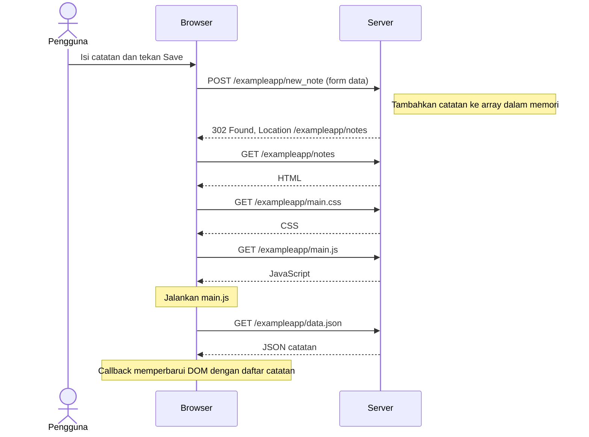

# 0.4 — Menyimpan catatan melalui formulir biasa

Status: **draft dengan bantuan Codex, peserta menyatakan sudah meninjau; belum dikumpulkan**. Disusun dari materi resmi, bukan klaim bahwa peserta telah mengamati atau membaca semuanya.

Sumber: [Full Stack Open — Fundamentals of Web apps](https://fullstackopen.com/en/part0/fundamentals_of_web_apps/).

Urutan permintaan CSS dan JavaScript dapat berbeda atau berjalan bersamaan.
Diagram menunjukkan dependensi utama, bukan rekaman Network dari peserta.

Untuk ditinjau: mengapa browser meminta halaman notes lagi setelah POST?
