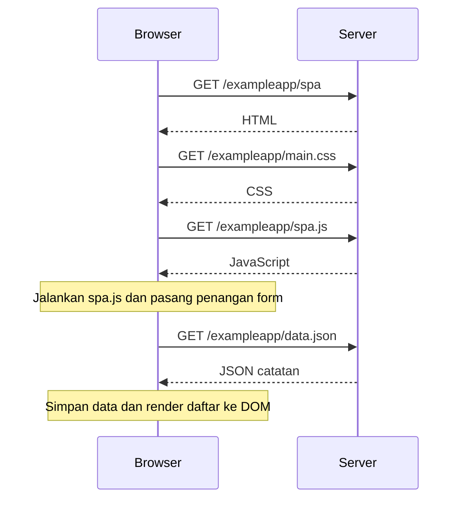

# 0.5 — Membuka aplikasi single-page

Status: **draft dengan bantuan Codex, peserta menyatakan sudah meninjau; belum dikumpulkan**. Disusun dari materi resmi, bukan klaim bahwa peserta telah mengamati atau membaca semuanya.

Sumber: [Full Stack Open — Fundamentals of Web apps](https://fullstackopen.com/en/part0/fundamentals_of_web_apps/).

Permintaan aset dapat berjalan bersamaan. JavaScript mengambil data dan
membentuk daftar setelah respons tersedia.

Untuk ditinjau: bagian mana yang merender daftar catatan, browser atau server?
