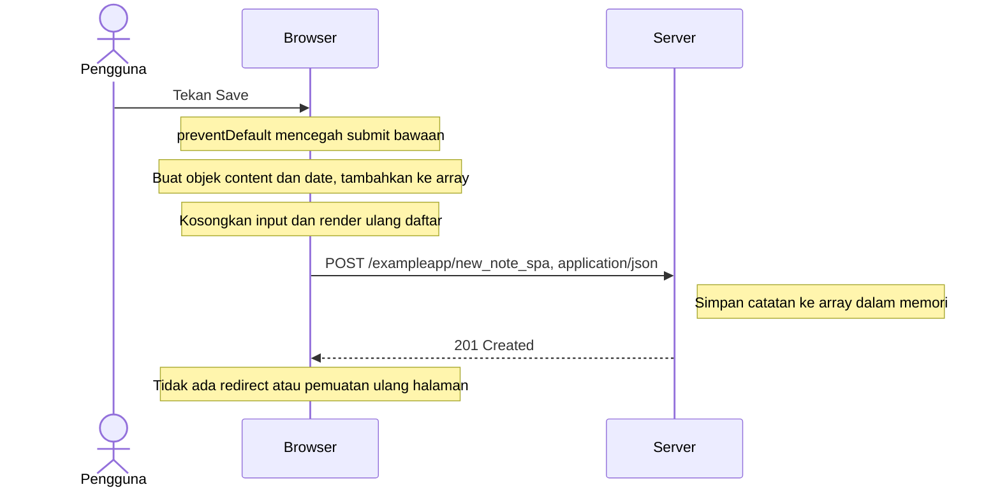

# 0.6 — Menyimpan catatan dalam aplikasi single-page

Status: **draft dengan bantuan Codex, peserta menyatakan sudah meninjau; belum dikumpulkan**. Disusun dari materi resmi, bukan klaim bahwa peserta telah mengamati atau membaca semuanya.

Sumber: [Full Stack Open — Fundamentals of Web apps](https://fullstackopen.com/en/part0/fundamentals_of_web_apps/).

Contoh kursus memperbarui tampilan sebelum respons server; diagram ini
mengikuti perilaku contoh tersebut.

Untuk ditinjau: apa perbedaan alur ini dengan formulir biasa pada latihan 0.4?
